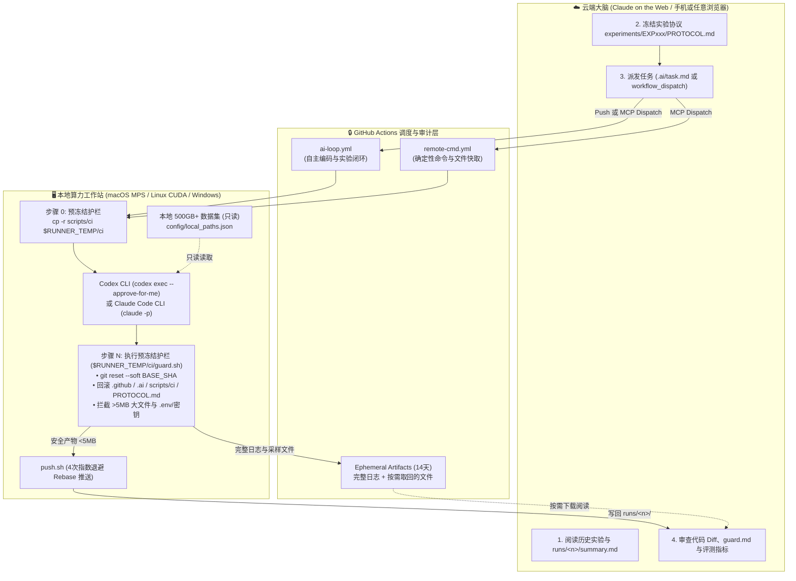
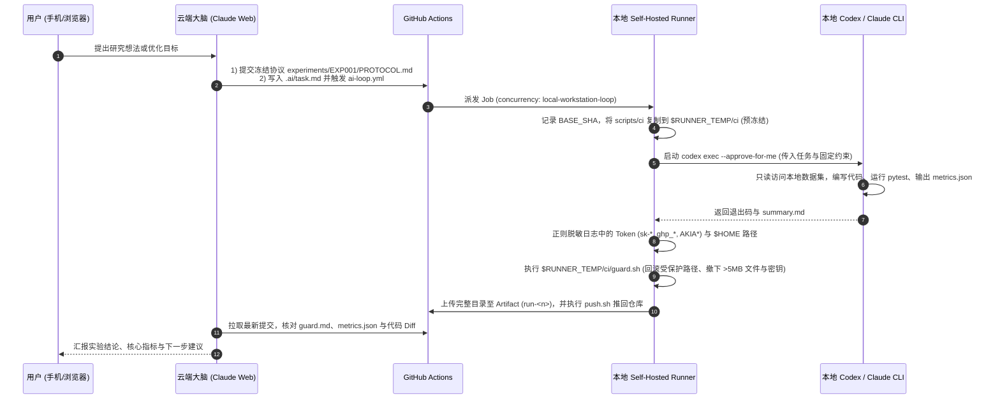

# Claude × Codex GitHub Loop (`claude-codex-github-loop`)

<p align="left">
  <a href="README.md"><strong>简体中文</strong></a> ·
  <a href="README_EN.md">English</a>
</p>

<p align="left">
  
  
  
  
  
</p>

> **云端大脑（Claude on the Web / Claude Code Cloud）+ 本地算力双手（Codex CLI / Claude Code CLI）的异步协同工程底座**  
> 基于 **GitHub Self-Hosted Runner** 与 **五重硬件级安全护栏（Pre-Frozen Guardrails）**，让你在手机或任意浏览器上用 Claude 规划实验，自动调度家里的 Mac Studio（Apple MPS）、Linux GPU 工作站（CUDA）或 Windows 台式机读取本地 **500GB+ 私有数据集**、编写代码、运行测试并安全回传结果。

---

## 为什么需要这个架构？

在日常 AI 研发与数据科学工作流中，开发者经常面临一个核心矛盾：
- **云端会话（Claude on the Web / Claude Code Cloud）** 是极佳的 **“大脑（Brain）”**：随时随地可用（手机/平板/浏览器）、擅长长上下文推理、实验设计与代码审查；但云端沙箱**无法访问你本机 500GB+ 的大体量数据集**（如医学影像、视频语料、本地评测集），也没有你本机的 Apple Silicon MPS 或 NVIDIA RTX 显卡。
- **本地工作站（macOS / Linux / Windows）** 拥有算力与数据，且安装了 **Codex CLI** 或 **Claude Code CLI** 作为 **“双手（Hands）”**；但跨公网直连本机目录无法在休眠/NAT 环境下稳定工作，Windows 也不支持云端直接挂载本地文件夹，而把几百 GB 的原始数据上传上云既昂贵又存在数据泄露风险。

本仓库提供一套经过高强度实战检验的 **GitHub Self-Hosted Runner 双通道异步闭环**：**原始数据 0 上传、无需公网 IP 或内网穿透、支持 macOS/Linux/Windows 全平台、且自带不可绕过的预冻结安全护栏**。

### 方案对比：为什么不用 SSH / 内网穿透 / 数据上云？

| 维度 | 传统方案：原始数据上云 | 传统方案：Ngrok / FRP 内网穿透 + SSH | Claude 本地文件夹直连 | **本方案 (`claude-codex-github-loop`)** |
|---|---|---|---|---|
| **500GB+ 本地私有数据集** | 需上传，慢且有泄露风险 | 本地直读，但暴露端口 | 本地直读 | **本地只读直通，0 字节原始数据上云** |
| **公网 IP / 端口映射要求** | 不需要 | 必须配置，易断连且有安全隐患 | 仅限本机浏览器 | **不需要（Runner 主动出站轮询 GitHub HTTPS）** |
| **跨平台支持** | 全平台 | 配置繁琐 | 仅支持 macOS / Linux | **原生支持 macOS、Linux、Windows (Git Bash)** |
| **防止 Agent 篡改协议或泄密** | 无，依赖 Prompt 约束 | 无，Agent 拥有完整写权限 | 无硬件级提交拦截 | **预冻结 `guard.sh`：强制回滚受保护路径、拦截 >5MB 文件与密钥** |
| **可审计性与回溯** | 差 | 无自动归档 | 会话内散落 | **每轮自动生成 `runs/<n>/` 报告、指标 JSON、护栏审计与 Git 记录** |

---

## 系统架构与工作流



### 单轮异步实验时序图



---

## 核心特性

### 1. 双通道 GitHub Actions 工作流（`.github/workflows/`）
- **`ai-loop.yml`（自主 Agent 编码与实验闭环）**
  - **三种触发方式**：推送 `.ai/task.md` 自动触发；`workflow_dispatch` 留空读取 `.ai/task.md`；或 `workflow_dispatch` 直接填入一次性 `task` 文本。
  - **多后端切换**：支持通过 `agent_backend` 选择 `codex`（`codex exec --approve-for-me`）、`claude`（`claude -p`）或 `python`（纯脚本模式）。
  - **结构化产物**：每次运行在 `runs/<run_number>/` 下产出 `summary.md`、`metrics.json`、`meta.json`、`guard.md`、`task.md` 和 `agent_tail.log`。
- **`remote-cmd.yml`（极速远程命令与安全文件采集器）**
  - 无需经过大模型，直接在本地执行确定性命令（如跑 `pytest`、运行 `survey.py` 查看本地目录树、运行 `smoke_test.py` 检查 CUDA/MPS 状态）。
  - **安全文件取回（`collect` 参数）**：用分号分隔路径或通配符（如 `~/projects/demo/**/*.py;~/projects/demo/README.md`），由 `collect.sh` 自动过滤 `.git`、`node_modules`、虚拟环境与密钥文件，打包进 14 天有效期的私有 GitHub Artifact 供云端大脑下载阅读，**绝不污染 Git 历史**。

### 2. 五重硬件级安全护栏（`scripts/ci/guard.sh` & `guard.py`）
为什么不能只靠 Prompt 告诉本地 Agent“不要改配置、不要传大文件”？因为大模型在自主调试时经常会为了修测试而误改协议或执行 `git add .` 把几百 MB 的缓存塞进仓库。本架构在 CI 层实现了**不可绕过的物理护栏**：
1. **护栏脚本预冻结（Pre-Freeze）**：在启动本地 Agent **之前**，Workflow 先把 `scripts/ci/` 复制到仓库外的 `$RUNNER_TEMP/ci`。即使 Agent 在运行过程中篡改甚至删除了工作区里的 `scripts/ci/guard.sh`，最终执行的依然是 `$RUNNER_TEMP/ci/guard.sh`。
2. **统一提交收口（Soft Reset）**：若 Agent 自行执行了 `git commit`，护栏会先执行 `git reset --soft "$BASE_SHA"`，将所有中间提交打回暂存区统一接受检查。
3. **受保护路径强制回滚**：自动检测并撤销对 `.github/`、`.ai/`、`.claude/`、`scripts/ci/` 以及任何 `**/PROTOCOL.md` 的修改或新增文件。**实验协议（`PROTOCOL.md`）只能由云端大脑冻结，本地 Agent 无法篡改裁判规则。**
4. **大文件自动拆弹（> 5 MB）**：任何超过 `MAX_MB`（默认 5 MB）的暂存文件会被自动 `git rm --cached`（文件仍完好保存在本地磁盘），从根源杜绝原始数据集或模型权重进入 Git。
5. **密钥拦截与日志脱敏**：自动从暂存区移除 `.env*`、`*.pem`、`*.key`、`id_rsa*`、`*secret*`、`*token*`、`*credential*` 等疑似凭据文件，并对 `runs/<n>/*` 日志中的 API Key（`sk-*`、`ghp_*`、`github_pat_*`、`AKIA*`）做正则脱敏。

### 3. 开箱即用的辅助工具集（`scripts/tools/`）
- [`scripts/tools/survey.py`](scripts/tools/survey.py)：跨平台目录普查工具。只读文件系统元数据和项目标识文件（不读文件内容），一键输出目录树、文件数、体积、Git 仓库状态（分支/最近提交/未提交改动数）、技术栈标签以及最近修改的 20 个文件。
- [`scripts/tools/smoke_test.py`](scripts/tools/smoke_test.py)：Runner 硬件与环境自检工具。验证主机名、OS/架构、Python 版本、文件读写探针、可用磁盘空间、PyTorch CUDA / Apple Silicon MPS 加速卡状态，以及 `config/local_paths.json` 中声明的数据集路径是否存在。
- [`scripts/tools/sandbox_runner.py`](scripts/tools/sandbox_runner.py)：可选的子任务隔离运行器。在 macOS 上支持原生 `sandbox-exec` 配置文件（拒绝访问 `/Users` 下除任务目录和显式授权目录外的一切路径），在全平台支持进程组级别的超时强杀（`SIGKILL`）。

---

## 5 分钟快速上手

### 第一步：使用本模板创建仓库
点击右上角 **Use this template** 创建你自己的仓库（建议包含私有实验记录时设为 Private，或使用本模板架构），并克隆到本地工作站：
```bash
git clone https://github.com/<your-username>/claude-codex-github-loop.git
cd claude-codex-github-loop
```

### 第二步：在本地工作站注册 GitHub Self-Hosted Runner
1. 打开你的 GitHub 仓库页面 -> **Settings** -> **Actions** -> **Runners** -> **New self-hosted runner**。
2. 按页面提示在本地电脑（macOS / Linux / Windows）下载并解压 Runner。
3. 运行 `./config.sh`（Windows 为 `config.cmd`）时，**为 Runner 添加标签 `ai-worker`**（与 `.github/workflows/ai-loop.yml` 中的 `runs-on: [self-hosted, ai-worker]` 对应）：
   ```bash
   ./config.sh --url https://github.com/<your-username>/<your-repo> --token <YOUR_TOKEN> --labels self-hosted,ai-worker
   ```
4. 启动 Runner（推荐注册为后台服务 `./svc.sh install && ./svc.sh start`，或在前台运行 `./run.sh`）。

### 第三步：配置本地只读数据集路径与 Agent CLI
1. 确保本地命令行已安装并登录 [`codex`](https://github.com/openai/codex) 或 `claude` CLI。
2. 复制本地路径配置模板并填入你电脑上的真实数据集路径（`config/local_paths.json` 已在 `.gitignore` 中排除，不会上传）：
   ```bash
   cp config/local_paths.example.json config/local_paths.json
   ```

### 第四步：在 Claude on the Web 中接入仓库
在浏览器或手机端打开 Claude on the Web / Claude Code Cloud，连接该 GitHub 仓库。Claude 会自动读取根目录下的 [`CLAUDE.md`](CLAUDE.md)。你可以直接发送以下首条指令验证闭环：

> **复制这段话发给云端 Claude：**  
> “请先阅读仓库根目录的 `CLAUDE.md` 和 `docs/WORKFLOW.md`。然后触发 `remote-cmd.yml` 工作流，在本地 Runner 上运行 `python3 scripts/tools/smoke_test.py`，等待运行完成后读取 `runs/cmd-<n>/output.txt`，向我汇报本地工作站的操作系统、CPU/GPU 加速状态以及本地数据集路径检查结果。”

---

## 实战踩坑指南（Troubleshooting & Pitfalls）

以下是我们在长期高频运行该闭环过程中踩过并已解决的 4 个关键工程深坑：

### 1. Windows Runner 的 `system32\bash.exe` 陷阱
- **现象**：当 Self-Hosted Runner 运行在 Windows 上时，如果在 YAML 里写 `shell: bash`，GitHub Runner 默认会调用 `C:\Windows\System32\bash.exe`（即 WSL 启动器）。如果机器没有安装 WSL 发行版，所有步骤会立刻报错退出；即便装了 WSL，其环境变量和路径格式也与宿主 Windows 环境隔离。
- **解决**：Windows 用户只需取消 `.github/workflows/ai-loop.yml` 和 `remote-cmd.yml` 顶部的 `defaults.run.shell` 注释，强制指定使用 **Git 自带的 Bash**：
  ```yaml
  defaults:
    run:
      shell: 'C:\Program Files\Git\bin\bash.exe --noprofile --norc -e -o pipefail {0}'
  ```

### 2. GitHub Actions 的 24 小时离线排队超时
- **现象**：如果你的本地工作站在夜间关机或休眠，此时云端大脑直接修改 `.ai/task.md` 触发了 `ai-loop.yml`，排队的 Job 会在 **24 小时**后被 GitHub 自动取消标红。
- **解决**：云端大脑在派发前先检查最近的 Run 是否在几秒内被接走。若本地机器离线，云端大脑会将下一轮任务写入 **`.ai/next_task.md`**（该文件不会触发 Workflow），等本地电脑开机上线后再将其移动为 `.ai/task.md` 并推送。

### 3. Codex CLI 的 `--approve-for-me` 与 `--sandbox` 参数冲突
- **现象**：在无交互 CI 脚本中调用 `codex exec` 时，如果同时传入 `--approve-for-me` 和 `--sandbox workspace-write`，Codex CLI 会直接报错退出。
- **解决**：`--approve-for-me` 内部已经自带了 `workspace-write` 沙箱策略，因此 `ai-loop.yml` 中仅使用 `codex exec --model "$CODEX_MODEL" --approve-for-me -o "$RUN_DIR/summary.md"`，并通过 `< /dev/null` 闭合标准输入防止挂起。

### 4. Rebase 冲突导致结果丢失
- **现象**：当本地 Runner 跑完 40 分钟的实验准备 `git push` 时，如果云端大脑或用户在期间推送了新的文档提交，普通的 `git push` 会因为 non-fast-forward 被拒绝。
- **解决**：[`scripts/ci/push.sh`](scripts/ci/push.sh) 内置了 **4 次指数退避重试（5s / 10s / 15s / 20s）** 的 `git pull --rebase --autostash`，并且即使极端情况下推送失败，所有产物也已经提前通过 `actions/upload-artifact@v4` 安全保存在 GitHub Artifact 中。

---

## 目录结构

```text
claude-codex-github-loop/
├── .ai/
│   ├── task.md                        # 当前轮次任务说明书（修改并推送即触发 ai-loop.yml）
│   └── next_task.md.example           # 本地机器离线时的下一轮任务暂存模板（规避 24h 超时）
├── .github/workflows/
│   ├── ai-loop.yml                    # 通道 A：自主编码与实验闭环（Codex / Claude / Python）
│   ├── remote-cmd.yml                 # 通道 B：确定性远程命令执行与私有文件采集器
│   └── ci-tests.yml                   # GitHub 托管 Runner 单元测试流水线
├── config/
│   └── local_paths.example.json       # 本地只读数据集与模型权重目录配置模板
├── docs/
│   ├── WORKFLOW.md                    # 完整工作流操作手册（中文）
│   └── WORKFLOW_EN.md                 # 完整工作流操作手册（英文）
├── experiments/
│   └── EXP001_example_benchmark/
│       └── PROTOCOL.md                # 冻结实验协议示例（受 guard.sh 硬件级保护，不可被 Agent 篡改）
├── scripts/
│   ├── ci/
│   │   ├── guard.py                   # 跨平台 Python 版五重安全护栏实现
│   │   ├── guard.sh                   # Bash 版五重安全护栏脚本（运行前预冻结至 $RUNNER_TEMP/ci）
│   │   ├── collect.sh                 # 安全文件采集脚本（过滤密钥/缓存，限制单文件 ≤20MB、总量 ≤100MB）
│   │   └── push.sh                    # 带 4 次指数退避 pull --rebase --autostash 的安全推送脚本
│   └── tools/
│       ├── survey.py                  # 本地工作区目录树、Git 状态与技术栈普查工具
│       ├── smoke_test.py              # 本地硬件、OS、CUDA/MPS 加速卡与数据路径自检工具
│       └── sandbox_runner.py          # 支持 macOS sandbox-exec 与全平台进程组超时控制的隔离运行器
├── tests/
│   └── test_guard_and_tools.py        # 针对护栏回滚、大文件拦截、密钥过滤与工具集的完整单元测试
├── CLAUDE.md                          # 供 Claude on the Web 自动读取的云端大脑操作指令
├── LICENSE                            # MIT 开源协议
└── pyproject.toml                     # Python 项目与 pytest 配置
```

---

## 运行单元测试

本仓库为 `guard.py`、`guard.sh`、`collect.sh`、`survey.py` 和 `smoke_test.py` 编写了完整的自动化测试（在临时 Git 仓库中模拟流氓 Agent 篡改 `.github/`、修改 `PROTOCOL.md`、制造超限大文件、写入 `.env` 密钥并自行提前 `git commit` 等攻击场景）：

```bash
pytest -v
```

---

## 引用 (Citation)

如果本仓库的架构或护栏设计对你的 AI 工程流有帮助，欢迎 Star 或引用：

```bibtex
@software{xu2026claudecodexloop,
  author       = {Xu, Yuchen},
  title        = {claude-codex-github-loop: Asynchronous Cloud-Brain and Local-Hands Engineering Loop via GitHub Self-Hosted Runners},
  year         = {2026},
  publisher    = {GitHub},
  url          = {https://github.com/ychenfen/claude-codex-github-loop}
}
```

## 开源协议 (License)

本项目采用 [MIT License](LICENSE) 开源。
