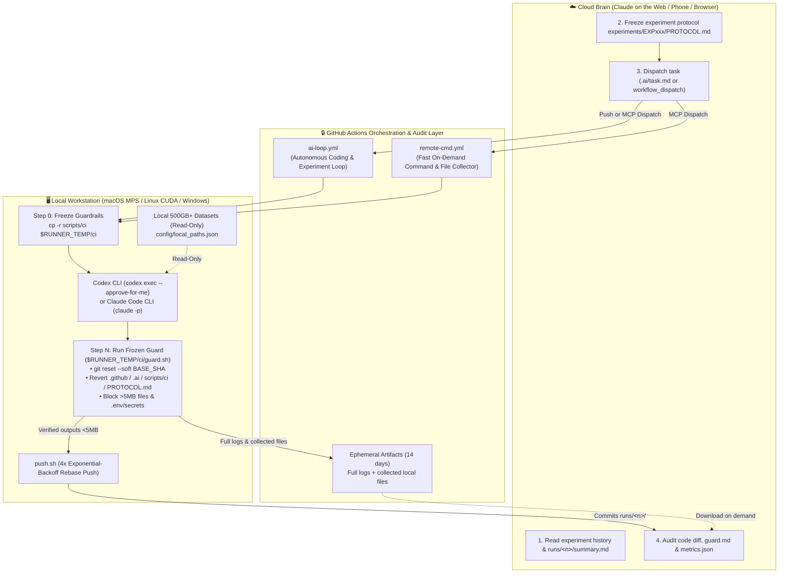

# Claude × Codex GitHub Loop (`claude-codex-github-loop`)

<p align="left">
  <a href="README.md">简体中文</a> ·
  <a href="README_EN.md"><strong>English</strong></a>
</p>

<p align="left">
  
  
  
  
  
</p>

> **Cloud Brain (Claude on the Web / Claude Code Cloud) + Local Hands (Codex CLI / Claude Code CLI) Asynchronous Collaboration Loop**  
> Built on **GitHub Self-Hosted Runners** with **Pre-Frozen Security Guardrails**. Plan experiments from your phone or browser in Claude Web while automatically dispatching your local Mac Studio (Apple MPS), Linux GPU rig (CUDA), or Windows workstation to read **500GB+ local datasets**, write code, run tests, and push back verified `< 5 MB` metrics.

---

## Why This Architecture Exists

Many developers and ML researchers use **Claude on the Web / Claude Code Cloud** as their reasoning **"Brain"** (accessible from any phone or browser, great at planning, hypothesis design, and auditing) alongside a **local macOS / Linux / Windows workstation** that holds **500GB+ local datasets**, Apple Silicon MPS or NVIDIA GPUs, and local **Codex CLI** or **Claude Code CLI** as the **"Hands"**.

Bridging the two usually hits a wall:
- Cloud containers cannot access your 500GB+ local dataset (e.g., medical imaging corpora, video datasets, local LLM evaluation harnesses), and uploading 500GB of private data to the cloud is slow, expensive, or unsafe.
- Direct local folder mounting does not work over the internet or on Windows.
- Giving an autonomous local agent raw `git push` permissions risks accidental modifications to CI workflows, tampering with evaluation protocols (`PROTOCOL.md`), or committing multi-gigabyte data files and `.env` secrets.

This template provides a battle-tested, production-grade **GitHub Self-Hosted Runner Asynchronous Loop** with **five hard security guardrails**.

### Comparison: Why Not SSH / Ngrok / Cloud Upload?

| Dimension | Upload Data to Cloud | Ngrok / Reverse SSH Tunnel | Local Folder Mount | **This Repo (`claude-codex-github-loop`)** |
|---|---|---|---|---|
| **500GB+ Local Datasets** | Must upload; expensive & risky | Local read, exposes ports | Local read | **Read-only local access; 0 bytes of raw data uploaded** |
| **NAT / Firewall Traversal** | N/A | Requires port forwarding / tunnel | Local machine only | **Zero inbound ports (Runner polls GitHub over HTTPS)** |
| **OS Support** | All | Fragile on Windows | macOS / Linux only | **macOS, Linux, and Windows (Git Bash)** |
| **Guard Against Rogue Agent Commits** | Prompt-only | Prompt-only | Prompt-only | **Pre-frozen `guard.sh` reverts protected paths & blocks >5MB / secrets** |
| **Auditability & Reproducibility** | Poor | None | Ephemeral chat | **Structured `runs/<n>/` metrics, `guard.md` audit, and Git history** |

---

## Architecture & Workflow



---

## Key Features

### 1. Two Complementary GitHub Actions Workflows (`.github/workflows/`)
- **`ai-loop.yml` (Autonomous Agent Loop)**:
  - Triggered by pushing `.ai/task.md` on `main`/`ai-loop` OR via `workflow_dispatch` with an inline `task` prompt.
  - Supports `AGENT_BACKEND=codex|claude|python`.
  - Copies `scripts/ci/` to `$RUNNER_TEMP/ci` *before* running the agent so even if the local agent modifies `scripts/ci/` during execution, the pre-frozen guardrail still runs.
  - Writes structured outputs to `runs/<run_number>/summary.md`, `metrics.json`, `meta.json`, `guard.md`, and `agent_tail.log`.
- **`remote-cmd.yml` (Fast On-Demand Command & File Collector)**:
  - Triggered via `workflow_dispatch` with `command`, `workdir`, `shell` (`bash` | `powershell` | `cmd`), `collect` (semicolon-separated glob patterns), and `commit` (`true` | `false`).
  - Lets the Cloud Brain inspect local directories (`survey.py`), run `pytest`, check GPU status (`smoke_test.py`), or collect specific files into a 14-day ephemeral Artifact without polluting Git history.

### 2. Five-Layer Hard Security Guardrails (`scripts/ci/`)
- **`guard.sh` & `guard.py`**:
  1. **Soft-Reset to `BASE_SHA`**: Collapses any commits made by the agent back to `BASE_SHA` so every change goes through one unified inspection gate.
  2. **Protected Path Reversion**: Automatically reverts any modifications or untracked additions to `.github/`, `.ai/`, `.claude/`, `scripts/ci/`, and any `**/PROTOCOL.md`.
  3. **Oversized File Gate (`> 5 MB`)**: Unstages any file larger than `MAX_MB` (default 5 MB) while keeping the file intact on the local workstation disk.
  4. **Credential & Secret Gate**: Blocks and unstages `.env*`, `*.pem`, `*.key`, `id_rsa*`, `*secret*`, `*token*`, `*credential*`, and scrubs token strings from run logs.
  5. **Transparent Audit Log**: Writes `runs/<run_number>/guard.md` detailing every reverted or blocked file.
- **`collect.sh`**: Safely stages requested local files into `$RUNNER_TEMP/out/collect` for artifact upload while skipping `.git`, `node_modules`, `.venv`, `.env*`, keys/secrets, and enforcing a 20 MB per-file and 100 MB / 3000-file cap.
- **`push.sh`**: Commits staged outputs and pushes with 4x exponential-backoff `git pull --rebase --autostash` retry.

### 3. Built-In Helper Tools (`scripts/tools/`)
- [`scripts/tools/survey.py`](scripts/tools/survey.py): Fast cross-platform workspace inventory script (prints directory tree, file counts, sizes, detected Git/language projects, and top 20 recent modifications).
- [`scripts/tools/smoke_test.py`](scripts/tools/smoke_test.py): Verifies runner identity, OS/arch, Python version, PyTorch CUDA / Apple MPS availability, disk space, and configured local data paths (`config/local_paths.example.json`).
- [`scripts/tools/sandbox_runner.py`](scripts/tools/sandbox_runner.py): Optional isolated Python task runner with process-group timeout and macOS `sandbox-exec` filesystem sandboxing.

---

## 5-Minute Setup Guide

1. **Create Your Repo from This Template**:
   ```bash
   git clone https://github.com/<your-username>/claude-codex-github-loop.git
   cd claude-codex-github-loop
   ```
2. **Register Your Local Self-Hosted Runner**:
   Go to **Settings -> Actions -> Runners -> New self-hosted runner** in your GitHub repository, and configure it with the `ai-worker` label:
   ```bash
   ./config.sh --url https://github.com/<your-username>/<your-repo> --token <YOUR_TOKEN> --labels self-hosted,ai-worker
   ./run.sh   # or install as a service: ./svc.sh install && ./svc.sh start
   ```
3. **Configure Local Dataset Paths**:
   ```bash
   cp config/local_paths.example.json config/local_paths.json
   # Edit config/local_paths.json with your local read-only dataset directories
   ```
4. **Connect Claude on the Web**:
   Open Claude on the Web / Claude Code Cloud, connect your repository, and ask Claude:
   > *"Read `CLAUDE.md` and `docs/WORKFLOW_EN.md`. Trigger `remote-cmd.yml` to run `python3 scripts/tools/smoke_test.py` on my local runner and report the hardware, GPU status, and dataset path checks."*

---

## Production Pitfalls & Solutions

1. **Windows `C:\Windows\System32\bash.exe` vs. Git Bash**:
   On Windows runners, bare `bash` invokes `system32\bash.exe` (the WSL stub), which fails if no WSL distro is installed. Uncomment `defaults.run.shell` in `.github/workflows/ai-loop.yml` and `remote-cmd.yml` to use Git Bash (`C:\Program Files\Git\bin\bash.exe --noprofile --norc -e -o pipefail {0}`).
2. **GitHub's 24-Hour Offline Runner Queue Expiration**:
   GitHub cancels queued workflow runs if a self-hosted runner stays offline for > 24 hours. When your workstation is asleep, stage the next task in `.ai/next_task.md` (which does not trigger `ai-loop.yml`), and rename it to `.ai/task.md` once the runner is online.
3. **Codex CLI `--approve-for-me` vs. `--sandbox` Flag Conflict**:
   In Codex CLI, `--approve-for-me` already configures a `workspace-write` sandbox. Passing `--sandbox` at the same time causes a CLI flag error.

---

## Running Unit Tests

```bash
pytest -v
```

## License

Released under the [MIT License](LICENSE).
